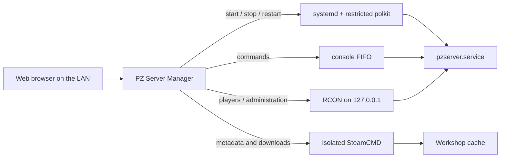

# PZ Server Manager

[Português (Brasil)](README.pt-BR.md)

A self-hosted web panel for administering a Project Zomboid Build 42 dedicated server on Debian with systemd.

[](LICENSE)
[](https://dotnet.microsoft.com/)
[](docs/debian-setup.md)

## Features

- **Server control and live console:** start, stop and restart the systemd service; follow journal output; send safe commands through a FIFO.
- **RCON players and whitelist:** list connected players, run typed administrative actions and inspect the whitelist database read-only.
- **Configuration editors:** conservatively edit the server INI and SandboxVars, including active-mod options and EN/PTBR translations, with conflict detection and atomic backups.
- **Workshop mods for Build 42:** download with the panel's isolated SteamCMD, inspect submods, select compatible version folders, resolve dependency order and configure maps.
- **World operations:** manual and scheduled backups, validated restore, and world reset while retaining configuration and optionally the whitelist.
- **Automation:** scheduled restarts and automatic game/mod update checks with mandatory backups and anti-loop state.
- **History and metrics:** configuration history with diffs and local seven-day CPU, memory and player charts.
- **Cardinal event director:** optional player-activity rules and an optional Anthropic-assisted director. It is off by default and all actions pass local safety checks.

## How it works



The panel runs as the unprivileged `pzmanager` account. The game runs separately as `pzserver`. Files under `deploy/linux` install the narrow systemd and polkit integration used by the panel.

## Requirements

- Debian 13 with systemd and polkit
- A Project Zomboid dedicated server installed with SteamCMD (App ID `380870`)
- .NET 8 SDK for development; the production publish is self-contained for `linux-x64`
- Root access during initial installation only
- A LAN or VPN trusted network; the supplied setup is intentionally not internet-facing

## Quick start (Debian 13)

1. Prepare Debian, the `pzserver` service account, SteamCMD and the firewall by following [Debian server preparation](docs/debian-setup.md).
2. Copy `deploy/linux/server.env` to `/etc/pzmanager/server.env`, then set `PZ_SERVER_NAME` and `PZ_ROOT`. Set the same server name and matching paths in `deploy/linux/appsettings.Production.json` before installing the panel.
3. Start the game once so it creates `<PZ_SERVER_NAME>.ini`, then configure its service:

   ```bash
   sudo bash deploy/linux/servidor/pz-parte2.sh '<join-password>' '<rcon-password>'
   ```

4. Install backup, restore and reset services:

   ```bash
   sudo install -m 755 deploy/linux/servidor/pz-zerar-mundo /usr/local/sbin/pz-zerar-mundo
   sudo bash deploy/linux/servidor/pz-backups-instalar.sh
   ```

5. On a development machine, create the self-contained package:

   ```powershell
   .\deploy\publicar-linux.ps1
   ```

6. Copy the resulting `artifacts/linux-x64` directory and `deploy/linux` to the server, create a tarball of the published directory, then run:

   ```bash
   sudo PANEL_ALLOW_CIDR=192.168.1.0/24 bash deploy/linux/servidor/pz-painel-instalar.sh /tmp/pzmanager.tgz deploy/linux
   sudo -u pzmanager /opt/pzmanager/PzServerManager.Web --set-password admin
   sudo systemctl enable --now pzmanager.service
   ```

7. Open `http://<server-address>:8085` from the allowed network.

The scripts are reference installers: read them and adjust RAM, paths, service hardening and firewall policy for your host before running them.

## Configuration

Two files intentionally describe the same managed instance:

- `/etc/pzmanager/server.env` is the single source used by server-side scripts. `PZ_SERVER_NAME` accepts `A-Z`, `a-z`, `0-9`, `_` and `-`, up to 32 characters. `PZ_ROOT` defaults to `/opt/pzserver`.
- `/opt/pzmanager/appsettings.Production.json` configures the web application. Set `PzManager:ManagedServer:ServerName` to the same value and customize `DisplayName`, paths, Build 42 version and listening URL.

The checked-in examples use `servertest` and `My PZ Server`. Do not expose RCON; it is expected on `127.0.0.1`.

### Upgrading an existing install

An existing installation named `myserver` remains compatible. Set `PZ_SERVER_NAME=myserver` in `/etc/pzmanager/server.env` and `ServerName` to `myserver` in `appsettings.Production.json`, then rerun the panel and backup installers so the rendered polkit rule matches the existing backup filenames. Existing data does not need to be renamed.

## Security model

- `pzmanager` has no sudo access.
- The generated polkit rule permits only start/stop/restart of `pzserver.service` and start of the explicit backup, restore, reset and update units. Restore filenames are bound to the validated configured server name.
- Panel passwords use PBKDF2-SHA256, login attempts are rate-limited, and authentication uses HTTP-only same-site cookies.
- Passwords and tokens are masked from configuration history and audit output.
- RCON stays on loopback. The example firewall restricts TCP/8085 to `PANEL_ALLOW_CIDR`; game ports are separate.
- The panel is designed for a trusted LAN or VPN. Put it behind an authenticated HTTPS reverse proxy before considering any wider exposure.

## Optional spear durability example

`deploy/linux/servidor/SpearDurability.lua` is an optional, synthetic server-side example that doubles spear durability. Copying it into the server Lua tree changes gameplay, so it is never installed automatically. It requires `DoLuaChecksum=false`; understand that trade-off before enabling it.

## Development

No extra NuGet packages are required. On Windows, run:

```powershell
& 'C:\Program Files (x86)\dotnet\dotnet.exe' test PzServerManager.sln -m:1 -nodeReuse:false
& 'C:\Program Files (x86)\dotnet\dotnet.exe' build-server shutdown
```

The solution contains .NET 8 projects for Domain, Application, Infrastructure and Blazor Server Web, plus xUnit tests. Test fixtures are synthetic; see [their note](tests/PzServerManager.Tests/Fixtures/README.md).

## Roadmap

- **Windows support:** provide equivalents for the Windows service, console input, event/log streaming, backups, Workshop management through `steamcmd.exe`, and safe game/mod updates.
- **.NET 10 migration:** move from .NET 8 before its support ends in November 2026.
- Maintenance-only fixes may land before archival; no Linux feature expansion is currently planned.

## License

Licensed under the [MIT License](LICENSE).
