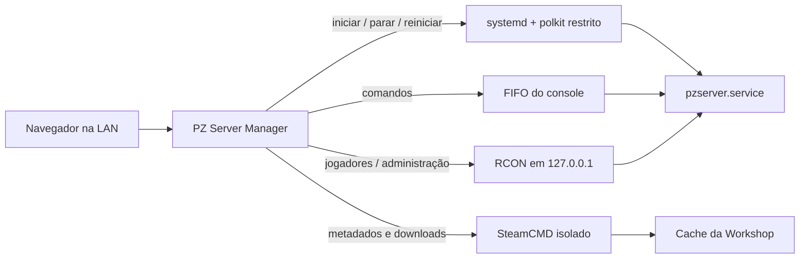

# PZ Server Manager

[English](README.md)

Painel web auto-hospedado para administrar um servidor dedicado de Project Zomboid Build 42 no Debian com systemd.

[](LICENSE)
[](https://dotnet.microsoft.com/)
[](docs/debian-setup.pt-BR.md)

## Recursos

- **Controle do servidor e console ao vivo:** inicia, para e reinicia o serviço systemd, acompanha o journal e envia comandos seguros por FIFO.
- **Jogadores e whitelist por RCON:** lista jogadores conectados, executa ações administrativas tipadas e consulta o banco da whitelist em modo somente leitura.
- **Editores de configuração:** edita com segurança o INI e o SandboxVars, incluindo opções dos mods ativos e traduções EN/PTBR, com detecção de conflito e backups atômicos.
- **Mods da Workshop para Build 42:** baixa pelo SteamCMD isolado do painel, inspeciona submods, escolhe pastas de versão compatíveis, ordena dependências e configura mapas.
- **Operações do mundo:** backup manual e agendado, restauração validada e zeragem do mundo preservando configurações e, opcionalmente, a whitelist.
- **Automação:** reinícios agendados e verificação/aplicação automática de updates do jogo e dos mods, com backup obrigatório e trava contra repetição.
- **Histórico e métricas:** histórico de configurações com diff e gráficos locais de CPU, memória e jogadores dos últimos sete dias.
- **Diretor de eventos Cardinal:** regras opcionais baseadas na atividade e diretor opcional assistido pela Anthropic. Nasce desligado e toda ação passa pelas proteções locais.

## Como funciona



O painel roda com a conta sem privilégios `pzmanager`; o jogo roda separadamente como `pzserver`. Os arquivos em `deploy/linux` instalam a integração restrita com systemd e polkit.

## Requisitos

- Debian 13 com systemd e polkit
- Servidor dedicado do Project Zomboid instalado pelo SteamCMD (App ID `380870`)
- SDK .NET 8 para desenvolvimento; a publicação de produção é self-contained para `linux-x64`
- Acesso root somente durante a instalação inicial
- Uma LAN ou VPN confiável; a configuração fornecida não foi feita para exposição direta à internet

## Início rápido (Debian 13)

1. Prepare o Debian, a conta `pzserver`, o SteamCMD e o firewall seguindo [Preparação do servidor Debian](docs/debian-setup.pt-BR.md).
2. Copie `deploy/linux/server.env` para `/etc/pzmanager/server.env` e ajuste `PZ_SERVER_NAME` e `PZ_ROOT`. Antes de instalar o painel, use o mesmo nome e caminhos correspondentes em `deploy/linux/appsettings.Production.json`.
3. Inicie o jogo uma vez para criar `<PZ_SERVER_NAME>.ini` e configure o serviço:

   ```bash
   sudo bash deploy/linux/servidor/pz-parte2.sh '<senha-de-entrada>' '<senha-rcon>'
   ```

4. Instale os serviços de backup, restauração e zeragem:

   ```bash
   sudo install -m 755 deploy/linux/servidor/pz-zerar-mundo /usr/local/sbin/pz-zerar-mundo
   sudo bash deploy/linux/servidor/pz-backups-instalar.sh
   ```

5. Em uma máquina de desenvolvimento, gere o pacote self-contained:

   ```powershell
   .\deploy\publicar-linux.ps1
   ```

6. Copie `artifacts/linux-x64` e `deploy/linux` para o servidor, compacte a publicação e execute:

   ```bash
   sudo PANEL_ALLOW_CIDR=192.168.1.0/24 bash deploy/linux/servidor/pz-painel-instalar.sh /tmp/pzmanager.tgz deploy/linux
   sudo -u pzmanager /opt/pzmanager/PzServerManager.Web --set-password admin
   sudo systemctl enable --now pzmanager.service
   ```

7. Abra `http://<endereço-do-servidor>:8085` a partir da rede permitida.

Os scripts são instaladores de referência: revise RAM, caminhos, endurecimento do serviço e política de firewall antes de executá-los.

## Configuração

Dois arquivos descrevem intencionalmente a mesma instância:

- `/etc/pzmanager/server.env` é a fonte única para os scripts do servidor. `PZ_SERVER_NAME` aceita `A-Z`, `a-z`, `0-9`, `_` e `-`, com até 32 caracteres. `PZ_ROOT` usa `/opt/pzserver` por padrão.
- `/opt/pzmanager/appsettings.Production.json` configura a aplicação web. Use o mesmo valor em `PzManager:ManagedServer:ServerName` e ajuste `DisplayName`, caminhos, versão da Build 42 e URL de escuta.

Os exemplos versionados usam `servertest` e `My PZ Server`. Não exponha o RCON; ele deve ficar em `127.0.0.1`.

### Atualizando uma instalação existente

Uma instalação existente chamada `myserver` continua compatível. Defina `PZ_SERVER_NAME=myserver` em `/etc/pzmanager/server.env` e `ServerName` como `myserver` em `appsettings.Production.json`; depois rode novamente os instaladores do painel e de backups para que a regra polkit gerada reconheça os backups existentes. Não é necessário renomear os dados.

## Modelo de segurança

- `pzmanager` não recebe sudo.
- A regra polkit gerada permite somente start/stop/restart de `pzserver.service` e start das unidades explícitas de backup, restauração, zeragem e atualização. O nome restaurável fica preso ao nome validado do servidor.
- Senhas do painel usam PBKDF2-SHA256, tentativas de login são limitadas e a autenticação usa cookies HTTP-only e same-site.
- Senhas e tokens são mascarados no histórico e na auditoria.
- O RCON fica no loopback. O firewall de exemplo restringe TCP/8085 a `PANEL_ALLOW_CIDR`; as portas do jogo são tratadas separadamente.
- O painel foi projetado para LAN ou VPN confiável. Use um proxy reverso HTTPS autenticado antes de cogitar exposição mais ampla.

## Exemplo opcional de durabilidade

`deploy/linux/servidor/SpearDurability.lua` é um exemplo sintético opcional, somente do servidor, que dobra a durabilidade das lanças. Ele não é instalado automaticamente porque altera a jogabilidade. Requer `DoLuaChecksum=false`; avalie essa decisão antes de ativá-lo.

## Desenvolvimento

Sem pacotes NuGet adicionais. No Windows:

```powershell
& 'C:\Program Files (x86)\dotnet\dotnet.exe' test PzServerManager.sln -m:1 -nodeReuse:false
& 'C:\Program Files (x86)\dotnet\dotnet.exe' build-server shutdown
```

A solução contém projetos .NET 8 de Domain, Application, Infrastructure e Web com Blazor Server, além dos testes xUnit. Os fixtures são sintéticos; veja [a nota](tests/PzServerManager.Tests/Fixtures/README.md).

## Roadmap

- **Suporte a Windows:** criar equivalentes para Windows Service, entrada do console, logs, backups, mods pelo `steamcmd.exe` e atualizações seguras do jogo e dos mods.
- **Migração para .NET 10:** sair do .NET 8 antes do fim do suporte em novembro de 2026.
- Correções de manutenção podem entrar antes do arquivamento; não há expansão de recursos Linux planejada.

## Licença

Licenciado sob a [Licença MIT](LICENSE).
